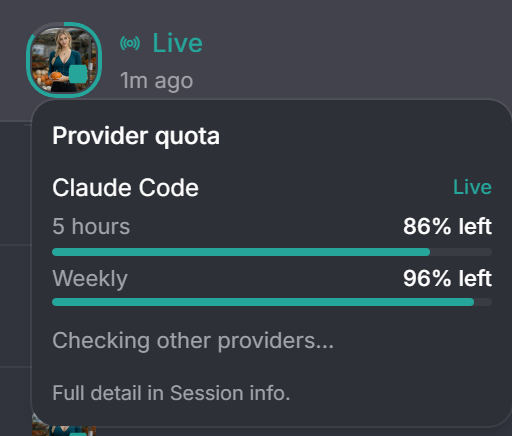

# Live quota border

The Live row's avatar in the discussion sidebar carries a thin border showing how
much quota the Live discussion's provider has left, measured on its most
constrained window. The border fills clockwise from 12 o'clock: teal for what is
left, gold from 90% used, red at 100%. It is absent when the provider reports no
quota.

Hovering or clicking the avatar opens a compact summary of every provider that
reports quota, with the Live's provider marked. Clicking the avatar does not
select the Live discussion; the rest of the row still does. The full detail stays
in Session info.

The border reads the shared provider-usage cache that Session info also feeds. It
never forces a provider refresh: it asks on mount and when the Live discussion's
activity changes, and the summary asks once per provider when opened.
